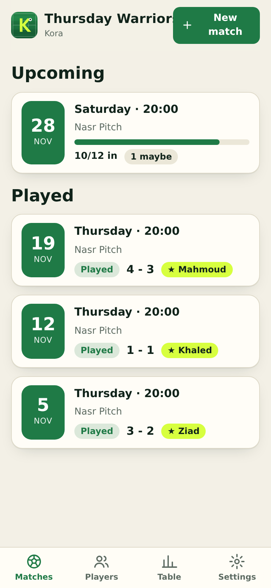
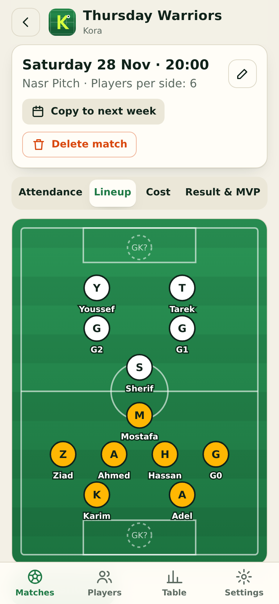
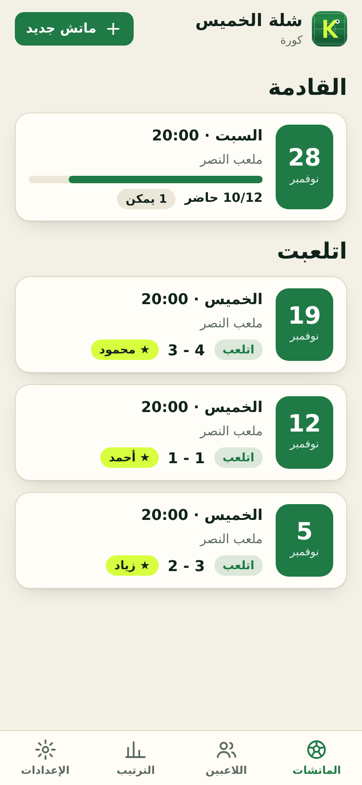

<p align="center"></p>
<h1 align="center">Kora | كورة</h1>
<p align="center"><b>Your weekly football night, sorted.</b><br>Attendance, balanced lineups, pitch cost split and an MVP vote. Free, private, Arabic and English.</p>
<p align="center"><a href="https://yousefkhames.github.io/kora/"><b>Open the live app</b></a></p>

<p align="center">
  
  
  
</p>

## The pitch

Every week the same group chat chaos: who is in, who is out, who brings the bibs, who owes the pitch money, who was the best player. Kora puts all of it in one small app that runs in the browser. No account, no server, nothing to install.

## Features

- **Matches.** Create a weekly match (date, time, venue, 5 to 11 a side, pitch cost). One tap copies a match to next week.
- **Attendance.** In / Maybe / Out per player. Pitch capacity is enforced: extra sign-ups join a waitlist in sign-up order and move up automatically when someone drops out. Add one-off guests.
- **Balanced lineups.** Teams are built from each player's rating (1 to 5) and position (keeper, defender, midfield, forward). Keepers are split between teams, then a swap search reduces the rating gap. Reshuffle for another option, or move any player by hand. A pitch diagram shows both teams in a sensible formation.
- **Cost split.** Pitch cost plus extras (water, referee, ball) divided between everyone who plays. Amounts are integer piasters so the shares always add up exactly. Optionally round each share up to 5 / 10 / 50 and see the surplus. Mark who has paid, see what is outstanding, copy a payment reminder.
- **Result and stats.** Score, goals and assists per player.
- **MVP vote.** Secret ballot on one phone: pick who is voting, then who played best. Nobody can vote for themselves, a changed vote replaces the old one, and results stay hidden until you close voting. Ties are resolved by the organiser.
- **Season table.** Points, W/D/L, goals, assists, MVPs, attendance rate and who still owes money. Sortable.
- **Share.** Copy-ready invite, lineup and payment messages for your group chat.
- **Arabic and English**, full right-to-left layout, light and dark theme, your own accent colour and currency.
- **Backup.** Export and import everything as JSON.
- Works offline after the first visit, and can be added to a phone home screen.

## Tech

Plain HTML, CSS and JavaScript. No framework, no build step, no dependencies at runtime. Data lives in `localStorage`. The app logic is a separate pure module (`docs/core.js`) so it can be tested in Node.

```
docs/core.js    state, attendance, team balancing, money, voting, season stats
docs/app.js     UI, routing, modals, actions
docs/i18n.js    English and Arabic strings
docs/sw.js      offline cache (network first)
tests/          unit tests (node:test) and a real-browser click-through (puppeteer-core + Chrome)
```

## Run and test

```bash
npm install            # only needed for the browser test
npm run serve          # http://localhost:8080
npm test               # 17 unit tests, no dependencies
npm run test:e2e       # 40 checks in headless Chrome (set CHROME=/path/to/chrome if needed)
```

The browser test clicks through the whole app on a phone-size screen: demo squad, attendance and waitlist, lineups, cost split, result, secret vote, season table, Arabic and RTL, backup export and import, reset, and script-injection safety.

## Honest limits

- **Your data stays in one browser.** There is no sync. Clearing site data erases it, so export a backup now and then. Two organisers on two phones will not see each other's changes.
- **The MVP vote is pass-the-phone.** Without a server there is no way to vote from separate devices, and the app trusts whoever holds the phone.
- **Nobody is notified.** Kora writes the invite, lineup and reminder text for you to paste into WhatsApp or similar. It does not send anything.
- **Balancing is a heuristic.** It gets close with ratings that are honest and works best with 8 or more players. With tiny groups or very uneven keepers the gap can be larger. Ratings are set by you.
- **Payments are bookkeeping only.** Kora tracks who paid; it moves no money.
- Dates use your device's calendar and clock. The season table covers every played match, there is no season reset other than deleting matches.
- The Arabic text is written in Egyptian colloquial style. It has not been reviewed by a second native speaker.

## License

MIT. See [LICENSE](LICENSE).
